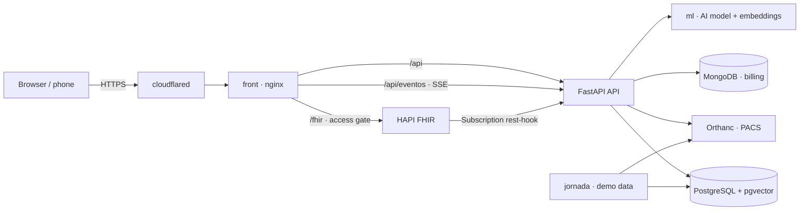
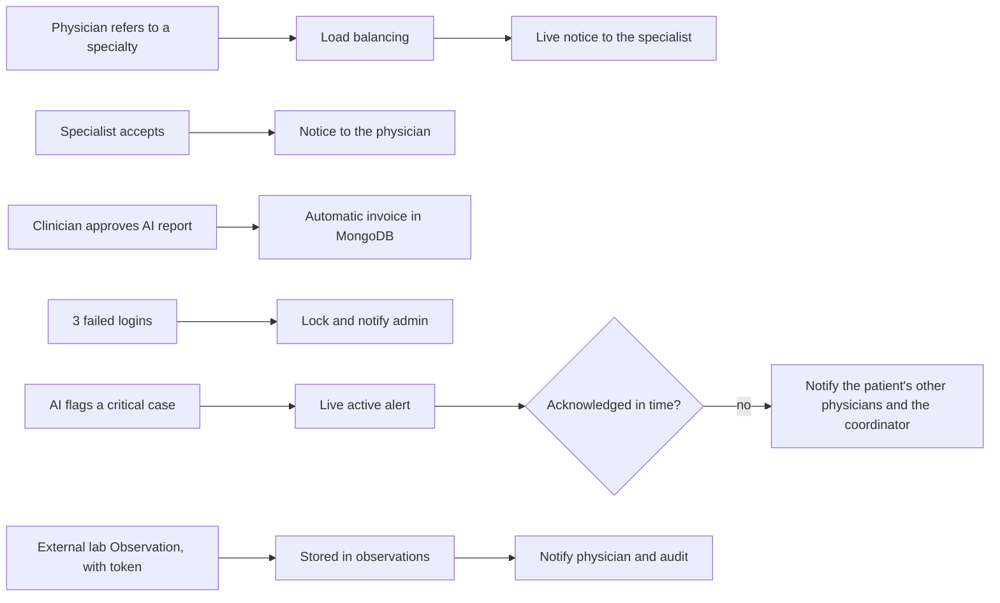

# Pulso · Real-time hospital capacity coordination

[](https://github.com/ShadowBlack33/Salud-digital-hsr/actions/workflows/ci.yml)
[](https://www.python.org/)
[](https://fastapi.tiangolo.com/)
[](https://react.dev/)
[](https://www.postgresql.org/)
[](https://www.mongodb.com/)
[](https://hl7.org/fhir/R4/)
[](https://docs.docker.com/compose/)

**Pulso** coordinates a hospital's beds, operating rooms and emergency department in real time. When something changes (a bed is freed, a referral arrives, a lab result comes back critical) the information reaches the person who has to act, live, with every step audited. It also includes a clinical assistant (RAG) that answers from cited guidelines and approved patient records, and abstains when it does not know.

Built for **Hospital San Rafael**, a hypothetical ~300-bed, 13-OR hospital sized after a high-complexity clinic in Cali, Colombia, with synthetic data calibrated against Colombian literature.

**Highlights**

- 11 services started with one `docker compose up -d`, published through Cloudflare Tunnel
- **260+ end-to-end checks** in CI against a real PostgreSQL; `main` protected by pull requests
- Field-level encryption, blind-index search and role-based access enforced by the API, not just the menu
- HL7 FHIR R4 interoperability with a `Subscription` that makes the system react to external data
- ICU-risk model trained on real surgical cases (VitalDB): sensitivity 0.80, AUC 0.71, always approved by a clinician
- Clinical RAG: **97 %** of paraphrased questions (66 of 68) answered citing the right guideline, and **30 of 30** unanswerable questions rejected

> My role: **technical lead**. Architecture, security, infrastructure, frontend and the RAG assistant. Team credits are [below](#team).

---

## The problem

In a high-complexity hospital, capacity is coordinated by phone and on boards nobody updates in time. A surgery is cancelled because there was no ICU bed, a clean bed stays empty for hours because nobody was told, a specialist learns about a referral too late. Colombian studies report elective-surgery cancellation rates between **2.7% and 7.6%**, with about **44%** due to administrative causes (Segnini et al., 2022), which is exactly what a coordination system can prevent.

## What it does

- **A dashboard per role.** The coordinator sees capacity and projected occupancy; the head nurse, their area and shift; the physician, their patients and critical cases; the accountant, billing only.
- **Everything arrives live.** A Server-Sent Events channel scoped by role: referrals, acceptances, critical alerts and lab notices show up within seconds, and wait in a persistent inbox if the person was offline.
- **One event triggers its consequences.** A referral to a specialty is load-balanced and notifies the specialist; approving an AI report creates the invoice in MongoDB; three failed logins lock the account and notify the admin; an unacknowledged critical alert escalates to the patient's other physicians and to the coordinator; a new FHIR `Observation` from an external lab notifies the responsible physician.
- **AI with a clinician in the loop.** The model estimates post-operative ICU risk, but its report enters the record only after a physician approves it. The model never receives data that identifies the patient.
- **A clinical assistant that cites or abstains.** Physicians, nurses, coordinators, accountants and patients ask questions in plain language; each role retrieves only what it is allowed to see.
- **No double bookings.** Two people cannot reserve the same OR, bed or surgeon at the same time, even from two phones in the same second.

## Technical highlights

| Area | What was built and why |
|---|---|
| **Security** | Personal fields encrypted with AES-256-GCM; search by ID number without decrypting via a blind index (HMAC-SHA256); Argon2id passwords; 15-minute JWT bound to an instantly revocable session; two-level RBAC (per endpoint and per record); lockout after 3 attempts; closed CORS, CSP and rate limiting in nginx. |
| **Privacy towards AI** | A pseudonymization layer sits between the API and the model: only clinical variables and a pseudonymous ID travel. The exact JSON the model received is stored and auditable (Colombian Law 1581 of 2012, purpose principle). |
| **Interoperability** | HL7 FHIR R4 on HAPI: patients, encounters, observations with LOINC, procedures with SNOMED CT and referrals as `ServiceRequest`. Bed and OR status use `Location.operationalStatus`, which the standard already defines for this. A rest-hook `Subscription` makes the system react to external data. |
| **Concurrency** | PostgreSQL advisory locks per OR and per clinician, `SELECT … FOR UPDATE` and optimistic checks on the expected state: of two simultaneous bookings, one is confirmed and the other gets a 409. |
| **Reactive architecture** | Every business action publishes an event; small *reactors* consume it (notify, bill, alert, escalate). The logic is not glued to each endpoint. |
| **Traceability** | Append-only audit log protected by a trigger, which never stores passwords or clinical text. Soft delete with history: nothing is erased, only the admin restores. |
| **Medical imaging** | Orthanc PACS with real chest X-rays from the NIH ChestX-ray14 cohort, visible from the patient record only to whoever can see that patient. |
| **Infrastructure** | 11 services in one `docker compose up -d`, published through Cloudflare Tunnel inside the compose. GitHub Actions CI with lint, build and 260+ end-to-end checks against real PostgreSQL. |

---

## Clinical assistant (RAG)

Answers clinical and operational questions from **18 guidelines with declared sources** (ADA, AABB, ASA, Surviving Sepsis, NEWS2, WHO surgical checklist, Colombian Ministry of Health resolutions) and from patients' **approved** records, with citations, abstention and auditing.

```
Question  ──► POST /rag/preguntar (role + own patient)
   ▼
Clinical filter in SQL ──► only guidelines and approved records this role may see
   ▼
BM25 + dense (pgvector), each section also indexed by the questions it answers
   ▼
RRF fusion ──► cross-encoder reranker (bge-reranker-v2-m3) ──► top 8
   ▼
Confident enough? ── no ──► abstain (the model is not called)
   │ yes
   ▼
Gemini writes ONLY from those passages and cites [F1]…[F8]
   ▼
Answer + citations ──► rag_consultas + audit log
```

- **Pseudonymized before indexing.** Records are written under a pseudonym (HMAC of the patient's blind index); name, surnames and ID are redacted everywhere, including free text a physician typed. A **canary check** searches for every identifier again before saving and refuses to index if one survives; an automated test proves it.
- **Paraphrased questions fixed by measurement, not by guesswork.** v1 retrieved the right guideline first for only 72 % of questions asked in the user's own words ("how long without eating before surgery?" never found the section on *fasting*). Three steps, each measured on 122 questions with an expected document (68 paraphrased) plus 30 unanswerable ones:
  1. **Bigger evaluation set**, so a change can be told apart from noise (each question used to be worth 7 points).
  2. **Questions per section in the index**: each guideline section carries the questions it answers, in plain words, generated with Gemini and reviewed by the team, each with its own vector. The model that writes the answer never sees them. Eval questions are never shown to the generator, and near-copies are filtered out.
  3. **Cross-encoder reranker** (`bge-reranker-v2-m3`, Apache 2.0, ONNX on CPU) over the top 20 candidates.

| Retrieval (first document correct) | Paraphrased (68) | Held-out split (61) | All (122) |
|---|---|---|---|
| Hybrid BM25 + dense (v1) | 72 % | 79 % | 79 % |
| + questions per section | 88 % | 89 % | 89 % |
| **+ reranker (v2)** | **90 %** | **95 %** | **93 %** |

  The dense weight in the fusion and the abstention thresholds were chosen on a tuning split; the held-out split never took part in any choice.

- **Abstention measured end to end with Gemini.** **30 of 30** unanswerable questions end in abstention (14 stopped by the retrieval gate, 16 rejected by the model), including traps close to the corpus (hypokalaemia when the guideline covers hyperkalaemia, a 2024 fee when only 2025 and 2026 are documented). **66 of 68** paraphrased questions are answered citing the expected guideline (v1: 11 of 15).
- **Reproducible answers.** Each query stores the model, temperature, prompt version, embedding signature (model + library version) and reranker used. Temperature is configurable and left at the provider's default, as Google recommends for Gemini 3.
- **Two models by question type.** A lite model for short factual questions and a stronger one for long or reasoning questions, with fallback between them and an extractive answer when no model is available, so the system and its tests work offline.
- **Live operational answers stay inside.** "How many free beds are there?" or "do I have alerts?" are answered from the same functions and permissions as the screens, and that data is never sent to the external model.

Full design, per-role retrieval table and limitations: [`docs/RAG.md`](docs/RAG.md) · results: [`docs/rag/eval/`](docs/rag/eval/).

---

## Architecture



### Automatic flows



Full event catalog: [`docs/EVENTOS.md`](docs/EVENTOS.md).

## Stack

| Layer | Technology |
|---|---|
| Backend | Python 3.12, FastAPI, SQLAlchemy 2, Pydantic |
| Data | PostgreSQL 16 with pgvector (Neon in the cloud), MongoDB 7 |
| Interoperability | HL7 FHIR R4 (HAPI FHIR), LOINC, SNOMED CT, ICD-10 |
| Imaging | Orthanc (DICOM) |
| AI | scikit-learn risk model and sentence-transformers embeddings in their own `ml` service; Gemini for the assistant |
| Frontend | React 19 + Vite, SPA served by nginx |
| Infrastructure | Docker Compose, Cloudflare Tunnel, GitHub Actions |

## Roles

Each role sees only what it needs, and the API enforces it.

| Role | Demo account | What they do |
|---|---|---|
| Administrator | `admin` | Users, unlocks, audit and system performance |
| Hospital coordinator | `coordinador` | Capacity per area, projected occupancy, quality indicators. Does not see patients |
| Head nurse | `jefe01`, `jefe_urg`, `jefe_uci` | Their area and shift: assign beds, request and receive transfers, schedule surgeries |
| Physician | `medico01` | Their patients and critical cases, AI analysis, referrals, discharge |
| Specialist | `especialista01` | Received referrals, their patients and their surgeries |
| Accountant | `contable01` | Billing in MongoDB. Nothing clinical |
| Patient | `paciente_demo` | Their location, surgery, images and charges |

The demo password is in the team's `.env` and in `tester.yaml`. The interface is in Spanish.

## Quick start

```bash
git clone https://github.com/ShadowBlack33/Salud-digital-hsr.git
cd Salud-digital-hsr
cp .env.example .env          # fill in keys and DATABASE_URL
docker compose up -d --build  # starts all services
```

- App: http://localhost:5173 · API and Swagger: http://localhost:8000/docs
- Public URL: `docker compose logs cloudflared | grep trycloudflare`
- New database: apply the scripts in `db/` in order (see [`docs/DESPLIEGUE.md`](docs/DESPLIEGUE.md)).
- Tests: `python scripts/test_e2e.py`, `python scripts/test_tiempo_real.py` and `python scripts/test_rag.py`.

## Data and model

- **Synthetic data, calibrated rather than invented.** Surgery cancellations between 2.7% and 7.6% with the cause split reported in Colombia, log-normal surgery durations, bed type by procedure and a crisis period that saturates the ICU to test the system under pressure.
- **Real images.** NIH ChestX-ray14 chest X-rays, labelled in the interface as an external, illustrative cohort. Details and licenses in [`docs/DATASETS.md`](docs/DATASETS.md).
- **Cluster-based augmentation.** Real VitalDB patients grouped into clusters, with synthetic patients generated inside each one and a clinical reading of every cluster.
- **ICU-risk model.** Trained on real VitalDB surgical cases (version `vitaldb-1`): sensitivity 0.80, specificity 0.47, AUC 0.71, with a 0.40 threshold chosen so critical cases are not missed. Threshold rationale and subgroup bias analysis in [`ml/UMBRAL.md`](ml/UMBRAL.md).

## Regulatory compliance

Designed against Colombian health and data regulation: Law 1581 of 2012, Law 2015 of 2020 and resolutions 866 of 2021, 1995 of 1999, 839 of 2017, 3100 of 2019 and 256 of 2016. Regulation → control → evidence matrix in [`docs/NORMATIVA.md`](docs/NORMATIVA.md); security rationale in [`docs/SEGURIDAD.md`](docs/SEGURIDAD.md).

## Known limitations

Stated as the path forward, not presented as working:

- Hospital patients are synthetic; the model was trained on real VitalDB cases but has not been validated on the institution's patients.
- No two-factor authentication; encryption keys live in environment variables, not a KMS.
- The patient key is their blind index; in production it would be a UUID.
- The Cloudflare URL changes when the tunnel restarts (no custom domain).
- Billing is an internal reference, not RIPS or DIAN e-invoicing.
- The RAG evaluation uses questions written by the team; generated index questions and eval questions target the same facts, so part of the gain may not transfer to real users. The next step is to measure on real, anonymized questions. On Gemini's free tier, pseudonymized text may be used by the provider; production would need the paid tier, a data agreement or a local model.
- Next version: outpatient visits, shift handover, medical orders, informed consent and the WHO surgical safety checklist as a workflow.

## Documentation

| Document | Contents |
|---|---|
| [`docs/DESPLIEGUE.md`](docs/DESPLIEGUE.md) | Deployment, migrations, tunnel and variables |
| [`docs/SEGURIDAD.md`](docs/SEGURIDAD.md) | Encryption, RBAC, sessions, audit and limitations |
| [`docs/MAPEO_FHIR.md`](docs/MAPEO_FHIR.md) | Tables → FHIR resources and terminologies |
| [`docs/EVENTOS.md`](docs/EVENTOS.md) | Event catalog, reactors and escalation |
| [`docs/RAG.md`](docs/RAG.md) | Clinical assistant: corpus, pseudonymization, retrieval, abstention |
| [`docs/CONTABILIDAD.md`](docs/CONTABILIDAD.md) | Billing documents in MongoDB |
| [`docs/DATASETS.md`](docs/DATASETS.md) | Image and tabular datasets, licenses and clusters |
| [`docs/NORMATIVA.md`](docs/NORMATIVA.md) | Regulatory map |
| [`ml/UMBRAL.md`](ml/UMBRAL.md) | Clinical threshold and model metrics |
| [`tester.yaml`](tester.yaml) | Automated verification contract |

Documentation is in Spanish, the language of the project.

## Team

| Member | Role |
|---|---|
| **Carlos Andrés Orozco Caicedo** | Technical lead · architecture, security, infrastructure, frontend and the RAG assistant |
| José David Mesa | Real time: event channel, inbox, reactors and reactive FHIR |
| Esteban Cobo | AI: model, pseudonymization, alerts and clinical record |
| Sara Rojas | Data: datasets, clusters and billing in MongoDB |
| Juan José García | Biomedical engineering: regulation, clinical validation and test contract |

## Context

Capstone project for the **Digital Health Systems** course, Data & AI Engineering, Universidad Autónoma de Occidente (Cali, Colombia), 2026-2.

## References

- Segnini, F. J., Domínguez-Torres, L. C., & Vega-Peña, N. (2022). Cancelación de procedimientos quirúrgicos electivos. *Iatreia*, 35(2), 175–182.
- Muñoz-Caicedo, A., Perlaza-Cuero, L. A., & Burbano-Álvarez, V. A. (2019). Causas de cancelación de cirugía programada en una clínica de alta complejidad de Popayán. *Rev. Fac. Med.*, 67(1), 17–21.
- Wang, X. et al. (2017). ChestX-ray8: Hospital-scale chest X-ray database. *CVPR*.
- HL7 FHIR R4 — https://hl7.org/fhir/R4/

> Academic project with synthetic data. Not for use with real patients.
