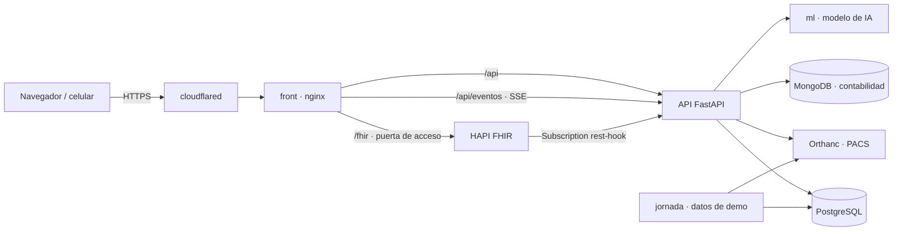
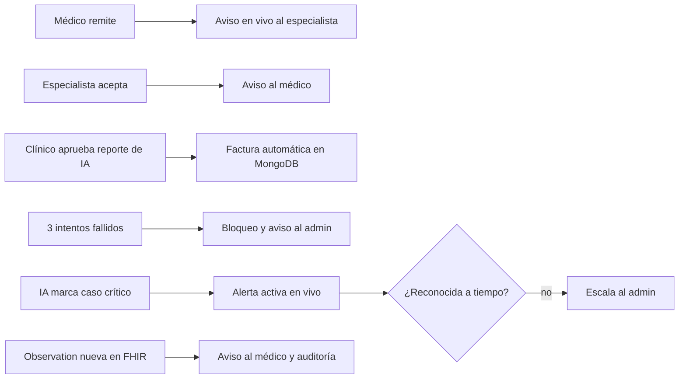

# Pulso · Coordinación hospitalaria en tiempo real

[](https://github.com/ShadowBlack33/Salud-digital-hsr/actions/workflows/ci.yml)
[](https://www.python.org/)
[](https://fastapi.tiangolo.com/)
[](https://react.dev/)
[](https://www.postgresql.org/)
[](https://www.mongodb.com/)
[](https://hl7.org/fhir/R4/)
[](https://docs.docker.com/compose/)

**Pulso** es una plataforma que coordina en tiempo real las camas, los quirófanos y las urgencias de un hospital. Cuando algo cambia (una cama se libera, llega una remisión, un laboratorio sale crítico) la información llega sola a la persona que tiene que actuar, sin recargar la página y con todo auditado.

Se construyó sobre **Hospital San Rafael**, un caso hipotético de ~300 camas y 13 quirófanos dimensionado a semejanza de una clínica de alta complejidad de Cali, con datos sintéticos calibrados con literatura colombiana.

> Proyecto integrador · Sistemas en Salud Digital · Universidad Autónoma de Occidente (Cali, Colombia), 2026-2.

---

## El problema

En un hospital de alta complejidad la capacidad se coordina por teléfono y en tableros que nadie actualiza a tiempo. Una cirugía se cancela porque no había cama de UCI, una cama limpia queda vacía horas porque nadie avisó, y un especialista se entera tarde de una remisión. La literatura colombiana reporta cancelaciones de cirugía programada entre **2,7 % y 7,6 %**, y cerca del **44 %** por causas administrativas (Segnini et al., 2022): justo lo que un sistema de coordinación puede evitar.

## Qué hace

- **Tablero de mando por perfil.** Cada persona entra a lo que necesita: el coordinador ve capacidad y ocupación proyectada; la enfermera jefe, su área y su turno; el médico, sus pacientes y sus críticos; el contable, solo facturación.
- **Todo llega en vivo.** Canal Server-Sent Events con alcance por rol: remisiones, aceptaciones, alertas críticas y avisos de laboratorio aparecen en segundos, y quedan en una bandeja persistente si la persona estaba desconectada.
- **Un hecho dispara consecuencias.** Remitir notifica al especialista; aprobar un reporte de IA genera la factura en MongoDB; tres intentos fallidos bloquean la cuenta y avisan al admin; un laboratorio nuevo en FHIR avisa al médico responsable.
- **IA con un clínico en el medio.** El modelo estima el riesgo de UCI posoperatoria, pero su reporte entra a la historia clínica solo si un médico lo aprueba. Al modelo nunca le llega un dato que identifique al paciente.
- **Coordinación sin choques.** Dos personas no pueden reservar el mismo quirófano, la misma cama o al mismo cirujano a la vez, aunque lo intenten desde dos celulares en el mismo segundo.

---

## Lo técnicamente interesante

| Área | Qué se hizo y por qué |
|---|---|
| **Seguridad** | Campos personales cifrados con AES-256-GCM; búsqueda por documento sin descifrar mediante índice ciego (HMAC-SHA256); contraseñas con Argon2id; JWT de 15 min ligado a una sesión revocable al instante; RBAC de dos niveles (por endpoint y por registro); bloqueo a los 3 intentos; CORS cerrado, CSP y límite de peticiones en nginx. |
| **Privacidad hacia la IA** | Capa de seudonimización entre la API y el modelo: solo viajan variables clínicas y un id seudónimo. El JSON exacto que recibió el modelo queda guardado y se puede auditar (Ley 1581 de 2012, principio de finalidad). |
| **Interoperabilidad** | HL7 FHIR R4 sobre HAPI: pacientes, encuentros, observaciones con LOINC, procedimientos con SNOMED CT y remisiones como `ServiceRequest`. El estado de camas y quirófanos usa `Location.operationalStatus`, que el estándar ya define para esto. Una `Subscription` rest-hook hace que el sistema reaccione a datos externos. |
| **Concurrencia** | Bloqueos consultivos de PostgreSQL por quirófano y por profesional, `SELECT … FOR UPDATE` y verificación optimista del estado esperado: de dos reservas simultáneas, una se confirma y la otra recibe 409. |
| **Arquitectura reactiva** | Cada acción de negocio publica un evento; pequeños *reactores* lo consumen (notificar, facturar, alertar, escalar). La lógica no queda pegada a cada endpoint. |
| **Trazabilidad** | Auditoría append-only protegida por trigger, que nunca guarda contraseñas ni texto clínico. Soft delete con historial: nada se borra; solo el admin restaura. |
| **Imágenes médicas** | PACS Orthanc con radiografías reales de la cohorte NIH ChestX-ray14, visibles desde la ficha solo para quien puede ver a ese paciente. |
| **Infraestructura** | 10 servicios en un solo `docker compose up -d`, publicados por Cloudflare Tunnel dentro del compose. CI en GitHub Actions con lint, build y **más de 260 verificaciones end-to-end** contra PostgreSQL real; `main` protegida por pull requests. |

---

## Arquitectura



### Flujos automáticos



El catálogo completo de eventos está en [`docs/EVENTOS.md`](docs/EVENTOS.md).

---

## Stack

| Capa | Tecnología |
|---|---|
| Backend | Python 3.12, FastAPI, SQLAlchemy 2, Pydantic |
| Datos | PostgreSQL 16 (Neon en la nube), MongoDB 7 |
| Interoperabilidad | HL7 FHIR R4 (HAPI FHIR), LOINC, SNOMED CT, CIE-10 |
| Imágenes | Orthanc (DICOM) |
| IA | scikit-learn en un servicio propio (`ml`), con umbral clínico documentado |
| Frontend | React 19 + Vite, SPA servida por nginx |
| Infraestructura | Docker Compose, Cloudflare Tunnel, GitHub Actions |

---

## Perfiles

Cada perfil ve solo lo que necesita, y la API lo hace cumplir (no solo el menú).

| Perfil | Cuenta de demo | Qué hace |
|---|---|---|
| Administrador | `admin` | Usuarios, desbloqueos, auditoría y rendimiento del sistema |
| Coordinador del hospital | `coordinador` | Capacidad por área, ocupación proyectada, indicadores de calidad. No ve pacientes |
| Enfermería jefe | `jefe01`, `jefe_urg`, `jefe_uci` | Su área y su turno: asigna camas, pide y recibe traslados, programa cirugías |
| Médico general | `medico01` | Sus pacientes y críticos, análisis de IA, remisiones, alta médica |
| Especialista | `especialista01` | Remisiones recibidas, sus pacientes y sus cirugías |
| Contable | `contable01` | Facturación en MongoDB. Nada clínico |
| Paciente | `paciente_demo` | Su ubicación, su cirugía, sus imágenes y lo que se le cobra |

La contraseña de las cuentas de demo está en el `.env` del equipo y en `tester.yaml`.

---

## Inicio rápido

```bash
git clone https://github.com/ShadowBlack33/Salud-digital-hsr.git
cd Salud-digital-hsr
cp .env.example .env          # completar claves y DATABASE_URL
docker compose up -d --build  # levanta los 10 servicios
```

- Aplicación: http://localhost:5173 · API y Swagger: http://localhost:8000/docs
- URL pública: `docker compose logs cloudflared | grep trycloudflare`
- Base de datos nueva: aplicar en orden los scripts de `db/` (ver [`docs/DESPLIEGUE.md`](docs/DESPLIEGUE.md)).
- Pruebas: `python scripts/test_e2e.py` y `python scripts/test_tiempo_real.py`.

---

## Datos y modelo

- **Datos sintéticos calibrados, no inventados.** Cancelación de cirugía entre 2,7 % y 7,6 % con el reparto de causas reportado en Colombia, duración quirúrgica log-normal, tipo de cama según el procedimiento y un periodo de crisis que satura la UCI para probar el sistema bajo presión.
- **Imágenes reales.** Radiografías de tórax del NIH ChestX-ray14, marcadas en la interfaz como cohorte externa e ilustrativa. Detalle y licencias en [`docs/DATASETS.md`](docs/DATASETS.md).
- **Aumento por clusters.** Pacientes reales de VitalDB agrupados y sintéticos generados dentro de cada grupo, con la interpretación clínica de cada uno.
- **Modelo de riesgo de UCI.** Versión provisional entrenada con datos sintéticos: sensibilidad 0,87, especificidad 0,53, AUC 0,80, con umbral elegido para no dejar pasar casos críticos. Son métricas del *pipeline*, no evidencia clínica; el criterio y el análisis por subgrupo están en [`ml/UMBRAL.md`](ml/UMBRAL.md).

---

## Cumplimiento normativo

El sistema se diseñó contra la normativa colombiana de salud y datos: Ley 1581 de 2012, Ley 2015 de 2020 y las resoluciones 866 de 2021, 1995 de 1999, 839 de 2017, 3100 de 2019 y 256 de 2016. La matriz norma → control → evidencia está en [`docs/NORMATIVA.md`](docs/NORMATIVA.md), y la justificación de seguridad en [`docs/SEGURIDAD.md`](docs/SEGURIDAD.md).

---

## Limitaciones conocidas

Se declaran como camino de evolución, no se presentan como algo que funcione:

- Todos los datos de pacientes son sintéticos; el modelo valida el proceso, no la precisión clínica.
- Sin doble factor de autenticación; las claves de cifrado viven en variables de entorno, no en un KMS.
- La llave del paciente es su índice ciego; en producción sería un UUID.
- La URL de Cloudflare cambia al reiniciar el túnel (no hay dominio propio).
- Facturación como referencia interna, no RIPS ni factura electrónica DIAN.
- Pendiente para la siguiente versión: consulta externa, entrega de turno, órdenes médicas, consentimiento informado y lista de cirugía segura de la OMS.

---

## Documentación

| Documento | Contenido |
|---|---|
| [`docs/DESPLIEGUE.md`](docs/DESPLIEGUE.md) | Despliegue, migraciones, túnel y variables |
| [`docs/SEGURIDAD.md`](docs/SEGURIDAD.md) | Cifrado, RBAC, sesiones, auditoría y limitaciones |
| [`docs/MAPEO_FHIR.md`](docs/MAPEO_FHIR.md) | Tablas → recursos FHIR y terminologías |
| [`docs/EVENTOS.md`](docs/EVENTOS.md) | Catálogo de eventos, reactores y escalamiento |
| [`docs/CONTABILIDAD.md`](docs/CONTABILIDAD.md) | Documentos de facturación en MongoDB |
| [`docs/DATASETS.md`](docs/DATASETS.md) | Datasets de imagen y tabular, licencias y clusters |
| [`docs/NORMATIVA.md`](docs/NORMATIVA.md) | Mapa normativo |
| [`ml/UMBRAL.md`](ml/UMBRAL.md) | Umbral clínico y métricas del modelo |
| [`tester.yaml`](tester.yaml) | Contrato de verificación automática |

---

## Equipo

| Integrante | Rol |
|---|---|
| **Carlos Andrés Orozco Caicedo** | Líder técnico · arquitectura, seguridad, infraestructura y frontend |
| José David Mesa | Tiempo real: canal de eventos, bandeja, reactores y FHIR reactivo |
| Esteban Cobo | Inteligencia artificial: modelo, seudonimización, alertas e historia clínica |
| Sara Rojas | Datos: datasets, clusters y contabilidad en MongoDB |
| Juan José García | Ingeniería biomédica: normativa, validación clínica y contrato de pruebas |

---

## Referencias

- Segnini, F. J., Domínguez-Torres, L. C., & Vega-Peña, N. (2022). Cancelación de procedimientos quirúrgicos electivos. *Iatreia*, 35(2), 175–182.
- Muñoz-Caicedo, A., Perlaza-Cuero, L. A., & Burbano-Álvarez, V. A. (2019). Causas de cancelación de cirugía programada en una clínica de alta complejidad de Popayán. *Rev. Fac. Med.*, 67(1), 17–21.
- Wang, X. et al. (2017). ChestX-ray8: Hospital-scale chest X-ray database. *CVPR*.
- HL7 FHIR R4 — https://hl7.org/fhir/R4/

> Proyecto académico con datos sintéticos. No usar con pacientes reales.
