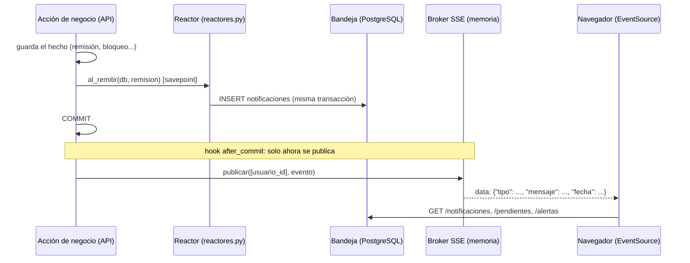
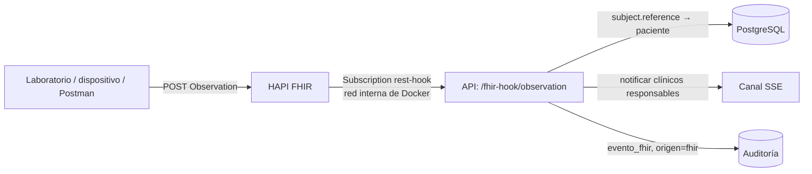

# Catálogo de eventos y sistema activo (R17 a R21)

Pulso no espera a que alguien pregunte: cuando ocurre un hecho, avisa a quien le
corresponde, factura o alerta, y lo deja auditado. Este documento dice **qué
evento existe, quién lo dispara, a quién llega y qué reacción provoca**, cómo
funciona el canal en vivo y qué garantías (y límites) tiene.

## 1. Cómo viaja un evento



Tres reglas del diseño:

1. **El hecho y su aviso se confirman juntos.** El reactor escribe la
   notificación dentro de la transacción del hecho. El evento en vivo se
   publica en el hook `after_commit` de SQLAlchemy: si la transacción se
   revierte, no sale ningún evento. Nadie recibe un aviso de algo que no pasó.
2. **Un reactor nunca tumba la acción de negocio.** Corre dentro de un
   `SAVEPOINT`: si falla (aunque sea un error de SQL), se deshace solo lo del
   reactor, se registra en el log y el hecho se confirma igual.
3. **El evento solo dice "algo cambió".** El front vuelve a pedir su bandeja,
   sus contadores y sus alertas; la API es la fuente de verdad. Si el canal
   estaba caído, nada se pierde: lo guardado en `notificaciones` se lee al
   reconectar (el front relee en cada `onopen`).

## 2. Catálogo de eventos

`Destinatarios` los elige el reactor por usuario. Además, `ROLES_POR_TIPO`
(`app/services/bandeja.py`) fija qué roles pueden recibir cada tipo, como
defensa en profundidad: aunque un reactor se equivocara de destinatario, un
paciente o un contable **nunca** recibe un evento clínico.

| `tipo` | Lo dispara | Llega a | No llega a | Reacción |
|---|---|---|---|---|
| `remision_nueva` | El médico remite (`POST /remisiones`) → `al_remitir` | El especialista destinatario (bandeja + canal) | Paciente, contable, quien remitió | Sube `remisiones_recibidas` del especialista |
| `remision_aceptada` | El especialista acepta → `al_aceptar` | El médico remitente | Paciente, contable | Baja `remisiones_recibidas` del especialista |
| `remision_rechazada` | El especialista rechaza (con motivo) → `al_rechazar` | El médico remitente | Paciente, contable | Baja `remisiones_recibidas`; el especialista pierde acceso a la ficha |
| `reporte_pendiente` | El análisis de IA crea un reporte `pendiente` → `al_reporte_pendiente` | El clínico que pidió el análisis | Paciente, contable | Sube `reportes_por_revisar` |
| `factura_creada` | Se **aprueba** un reporte de IA → `al_aprobar_reporte` | Los contables | Médicos, paciente | Crea sola la factura en MongoDB con `reporte_id` (una por reporte) |
| `factura_fallida` | Mongo no respondió al facturar | Contables y admin | Clínicos, paciente | Auditoría con `resultado=error`; no se pierde en silencio |
| `cuenta_bloqueada` | 3 intentos fallidos de contraseña → `al_bloquear` | Los admin (con el usuario afectado) | Todos los demás roles | El admin la desbloquea en Administración |
| `alerta_critica` | El modelo clasifica un caso como crítico → `al_alerta_critica` | El clínico responsable (`dirigida_a_usuario` de la alerta) | Paciente, contable, otros clínicos | Alerta `activa`: aviso persistente hasta que se reconozca con nota |
| `alerta_escalada` | La alerta lleva N min sin reconocer (servidor) | Los admin | Paciente, contable | Auditoría `escalar`; el clínico sigue viéndola activa |
| `fhir_observation` | Llega una Observation a HAPI (Subscription) | Los clínicos responsables del paciente | Paciente, contable | Auditoría con origen FHIR; el aviso dice qué llegó (p. ej. glucosa, LOINC 2339-0) |

Los avisos **no llevan nombre, documento ni texto clínico libre**: identifican
al paciente por su `paciente_id` (índice ciego) y el detalle se consulta en la
pantalla, donde sí rige el control de acceso por paciente. Es la misma regla de
la auditoría (`_sanear`) y de la Ley 1581/2012 (finalidad y circulación
restringida). El valor de una Observation entrante sí viaja en el aviso (es el
dato por el que se avisa), sin identificar a la persona.

## 3. El canal en vivo (R17)

`GET /eventos/stream` (en el navegador: `/api/eventos/stream`). Server-Sent
Events, `Content-Type: text/event-stream`.

| Aspecto | Cómo es |
|---|---|
| Autenticación | JWT de acceso por `?token=` (EventSource no envía cabeceras) o `Authorization`. Sin token o inválido: **401**. Se aplican las mismas reglas que a cualquier ruta: usuario activo, sesión no cerrada, cuenta no bloqueada |
| Formato | Cada evento es un JSON: `{"id", "tipo", "mensaje", "fecha", "leida", "paciente_id"?, ...ids del hecho}` (`remision_id`, `alerta_id`, `reporte_id`, `factura_id`, `observation_id`, `usuario_afectado`). Es el mismo objeto que devuelve `GET /notificaciones` |
| Inmediatez | Se publica en cuanto confirma la transacción; sin sondeo. En las pruebas llega en milisegundos (el límite del enunciado es 8 s) |
| Alcance por rol | Cada usuario recibe solo lo dirigido a él (ver sección 2). El broker no decide: entrega a los usuarios que el reactor nombró |
| Latido | Un comentario `: ping` cada 15 s mantiene viva la conexión a través del túnel de Cloudflare |
| Expiración | El token de acceso dura 15 min: al vencer, el servidor cierra el canal y el front lo reabre con el token renovado. Cada 60 s se revalida la sesión: cerrar sesión, bloquear o desactivar la cuenta corta el canal |
| Reconexión | El front reintenta a los 5, 10, hasta 30 s y, al conectar, relee bandeja y contadores |
| Nginx | `/api/eventos/` va con `proxy_buffering off`, `proxy_cache off` y `proxy_read_timeout 3600s`; la respuesta añade `X-Accel-Buffering: no`. El access log omite la query (`?token=`) |
| Límites | 10 pestañas por usuario (se cierra la más antigua); 200 eventos en cola por conexión (si un cliente no consume, se cierra y al reconectar relee su bandeja) |
| Réplicas | El broker vive en memoria del proceso: **una sola réplica de la API** (como está en el compose). Para escalar a varias, el mismo `publicar()` se reemplaza por Redis pub/sub sin tocar los reactores |

## 4. Bandeja y trabajo pendiente (R18)

| Ruta | Qué hace |
|---|---|
| `GET /notificaciones` | La bandeja del usuario: `[{id, tipo, mensaje, leida, fecha, paciente_id?, ...}]`, la más nueva primero. `?solo_no_leidas=true`, `?limite=` |
| `POST /notificaciones/{id}/leer` | Marca una como leída. La de otro usuario responde **404** (no se revela que existe) |
| `POST /notificaciones/leer-todas` | Marca toda la bandeja propia |
| `GET /pendientes` | `{"reportes_por_revisar", "remisiones_recibidas", "alertas_activas"}` |

Los cinco roles tienen bandeja (solo exige sesión; cada consulta se limita a las
filas del propio usuario). Los contadores se **calculan sobre el estado real**,
no se acumulan aparte, así que suben al nacer el trabajo y bajan al resolverse:

- `remisiones_recibidas`: remisiones `pendiente` dirigidas al personal del usuario.
- `reportes_por_revisar`: reportes de IA `pendiente` de los pacientes del clínico (alcance `assigned`).
- `alertas_activas`: alertas críticas `activa` del clínico; para el admin, las activas ya escaladas.

## 5. Alertas críticas y escalamiento (R20)

1. El módulo de IA (`app/api/ia.py`) inserta una fila en `alertas` (estado
   `activa`, con `dirigida_a_usuario` = el clínico responsable) y llama a
   `reactores.al_alerta_critica`.
   El evento tiene `tipo = alerta_critica` y llega por el canal.
2. La alerta sigue `activa` (y el front la muestra como aviso persistente con
   cuenta regresiva) hasta que un `medico` o `especialista` la reconoce con una
   nota (`POST /alertas/{id}/reconocer`, que pasa `estado` a `reconocida`).
3. **Escalamiento en el servidor** (`app/api/alertas.py`, del módulo de IA): cada
   cierto tiempo busca las alertas `activa` con más de
   `ALERTA_ESCALAMIENTO_MINUTOS` (5 por defecto, igual que la cuenta regresiva del
   front: `VITE_MINUTOS_ESCALAMIENTO`) sin reconocer, marca `escalada_at`, lo deja
   en la auditoría y llama a `reactores.al_alerta_escalada`, que avisa a los
   `destinatarios` (admin y otro clínico del paciente) con el evento
   `alerta_escalada`. Ocurre aunque el médico haya cerrado la pestaña.
4. Reconocimiento y creación quedan en la auditoría (a cargo del módulo de IA).

El umbral que decide qué es "crítico" lo define y justifica el modelo de IA
(R22: métricas y análisis de sesgo); este módulo solo entrega la alerta.

## 6. FHIR reactivo (R21)



- **Cómo avisa el servidor FHIR:** al arrancar, la API registra en HAPI la
  Subscription `pulso-observaciones` (`app/services/fhir_reactivo.py`): canal
  `rest-hook`, criterio sobre `Observation`, endpoint
  `http://api:8000/fhir-hook/observation`, payload `application/fhir+json` y el
  secreto compartido en la cabecera `X-Hook-Secret`. Es idempotente (id fijo; solo
  se reescribe si cambió o HAPI la dejó en error) y reintenta si HAPI aún no
  arrancó. No hay sondeo: HAPI empuja.
- **Receptor:** acepta POST o PUT y cualquier sub-ruta (según la versión, HAPI
  entrega a `{endpoint}` o a `{endpoint}/Observation/{id}`). Compara el secreto en
  tiempo constante y, sin `HOOK_SECRET`, rechaza todo. nginx **no** expone esa
  ruta hacia afuera (`/api/fhir-hook/` → 404): solo HAPI la alcanza.
- **Paciente:** por `subject.reference` (`Patient/<id>` → `pacientes.fhir_patient_id`)
  o, como respaldo, por `subject.identifier`.
- **Responsables:** quien registró al paciente, el médico o anestesiólogo de un
  encuentro activo y el especialista de una remisión pendiente o aceptada (las
  mismas reglas del alcance `assigned`).
- **Sin doble reacción:** `eventos_fhir` tiene llave única (recurso, id, versión):
  si HAPI reintenta, no se avisa dos veces. Las Observations que escribe la propia
  API (identificador del sistema del hospital) se ignoran (`origen_api`).
- **Paciente desconocido:** se audita (`resultado = error`) y no se avisa a nadie.
- **Auditoría:** `paciente` / `evento_fhir`, con `origen = fhir`, el id de la
  Observation, el código y cuántos clínicos se notificaron.

Comprobarlo contra el HAPI real: `python scripts/registrar_subscription.py --probar <fhir_patient_id>`.

## 7. Garantías y límites declarados

| Tema | Qué se garantiza | Límite conocido |
|---|---|---|
| Consistencia aviso-hecho | La notificación y el hecho confirman juntos; el evento sale tras el commit | Si el proceso muere **entre** el commit y la publicación, el evento en vivo se pierde (la notificación sí quedó guardada y se ve al reconectar). Un *outbox* con publicador aparte cerraría esa brecha; para una sola réplica y este alcance se considera aceptable |
| Factura automática | Idempotente por `reporte_id` (índice único + id derivado); se crea después del commit de la aprobación | MongoDB no participa de la transacción de PostgreSQL. Si Mongo falla, no se pierde en silencio (`factura_fallida` + auditoría) pero no se reintenta sola |
| Entrega | Un cliente desconectado no pierde nada: su bandeja está en la base | El canal en vivo no reentrega lo perdido; el front relee la bandeja al reconectar |
| Escala | Una réplica de la API (broker en memoria) | Con varias réplicas hace falta Redis pub/sub |
| Subscription | Se registra y verifica sola; criterio con respaldos si HAPI rechaza el primero | Probada con un servidor HAPI simulado; validar contra el HAPI real con el script de la sección 6 |

## 8. Contrato para los demás módulos

Los reactores ya están conectados a remisiones (`al_remitir`, `al_aceptar`,
`al_rechazar`) y a `/auth/login` (`al_bloquear`). El módulo de IA debe llamar
(después de guardar el hecho y antes del `commit`, con la misma sesión `db`):

| Cuándo | Llamada | Qué necesita el objeto (atributos o claves) |
|---|---|---|
| Crea un reporte `pendiente` | `reactores.al_reporte_pendiente(db, reporte)` | `id`, `paciente_id`, `creado_por` (id de usuario que pidió el análisis) |
| Aprueba un reporte | `reactores.al_aprobar_reporte(db, reporte)` | `id`, `paciente_id` |
| Inserta una alerta crítica | `reactores.al_alerta_critica(db, alerta)` | `id`, `paciente_id`, `dirigida_a_usuario`, `mensaje`, `nivel` |
| Escala una alerta vencida | `reactores.al_alerta_escalada(db, alerta)` | `id`, `paciente_id`, `dirigida_a_usuario`, `destinatarios` (lista de ids de usuario), `nivel` |

Tablas que este módulo lee y debe respetar el módulo de IA:

- `alertas` (extendida por `db/13_ia.sql`): `dirigida_a_usuario`, `paciente_id`,
  `estado` (`activa` | `reconocida`), `escalada_at`. `/pendientes` cuenta las
  `activa` del clínico y, para el admin, las `activa` con `escalada_at`.
- `reportes_ia` (`db/13_ia.sql`): `/pendientes` cuenta las filas con `estado = 'pendiente'` y
  `paciente_id` entre los pacientes del clínico (nombre de tabla en
  `app/api/eventos.py: TABLA_REPORTES_IA`). Si la tabla aún no existe, el
  contador es 0 y nada falla.

Facturación: `app/services/facturacion_auto.py` escribe en la colección
`facturas` de MongoDB el documento de `docs/CONTRATO_FACTURACION.md` (`id`
`F-IA-<reporte_id>`, `origen = automatica`, `servicio = analisis_ia`). El módulo
de contabilidad lee y opera esa misma colección.

## 9. Cómo se prueba

```bash
python scripts/test_tiempo_real.py     # canal por rol, bandeja, R19, alertas, FHIR (necesita db/13_ia.sql y db/14_notificaciones.sql)
python scripts/registrar_subscription.py --probar <fhir_patient_id>   # contra HAPI real
```

`test_tiempo_real.py` levanta la API en un servidor real, abre un canal por rol y
comprueba, entre otras cosas: rechazo sin token, entrega en vivo de una remisión
al especialista, que el paciente y el contable no reciban nada, los cuatro flujos
de R19, la factura única al aprobar dos veces, el aviso de escalamiento, la
reacción a una Observation (y que no reaccione dos veces) y que un reactor roto
no impida el commit.
