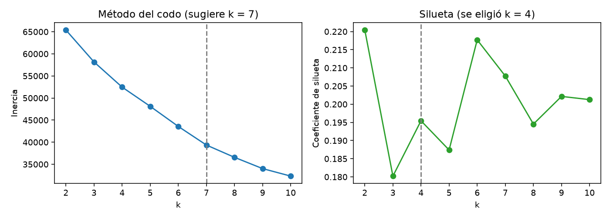
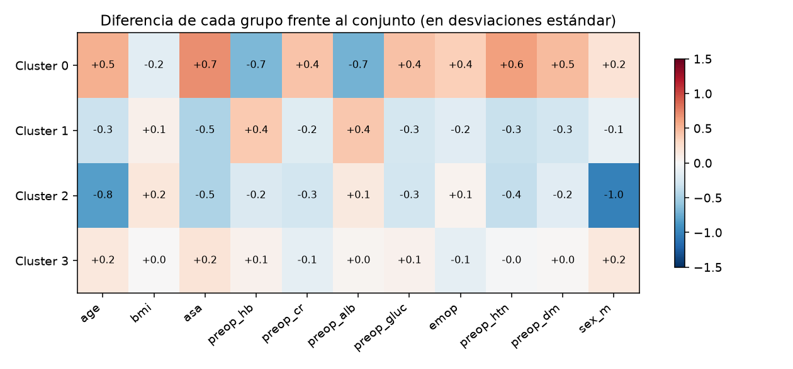

# Informe de clusters y aumento de datos (R07)

*Generado automáticamente por `scripts/clusters_vitaldb.py` el 2026-10-18. Semilla 42.*
*Los números de este informe son los de la corrida real: si se vuelve a ejecutar con otro archivo o semilla, cambian.*

## 1. Datos de partida

- **Fuente:** VitalDB (PhysioNet, v1.0.0), Seoul National University Hospital. Licencia CC BY 4.0.
  Cita: Lee H., Jung C. (2022). https://doi.org/10.13026/czw8-9p62
- Filas del archivo: **6,388**. Tras quitar casos sin edad, sexo, ASA o servicio:
  **6,255**. Tras quedarse con adultos (≥ 18 años): **6,199**.
  Tras descartar edades imposibles (error de captura): **6,199** casos reales.
- **Variables usadas para agrupar** (todas conocidas *antes* de operar): edad, IMC, ASA, hemoglobina,
  creatinina, albúmina y glucosa preoperatorias, cirugía de urgencia, hipertensión, diabetes, sexo y servicio quirúrgico.
- **Variables que NO se usan para agrupar:** los desenlaces (días en UCI, mortalidad, duración de la cirugía).
  Se emplean solo para describir cada grupo, así el agrupamiento no "sabe" lo que se quiere predecir.
- Valores fuera de rango clínico se tomaron como faltantes. Los faltantes (porcentaje por variable: preop_hb 3.3 %, preop_cr 4.1 %, preop_alb 3.9 %, preop_gluc 4.1 %)
  se rellenaron con la **mediana del conjunto de entrenamiento**, calculada después de separar entrenamiento y prueba.

## 2. Separación entrenamiento / prueba

Antes de agrupar y de generar sintéticos, los casos se separaron **por paciente** (`subjectid`):
**4,958** casos de entrenamiento y **1,241** de prueba (1,185 pacientes en prueba).
Un paciente con varias cirugías nunca queda de los dos lados. El agrupamiento y los sintéticos usan **solo el
entrenamiento**; los casos de prueba se asignan al cluster más cercano sin haber influido en él. Cualquier métrica
de un modelo debe calcularse únicamente con casos reales de prueba (columna `split = prueba`).

## 3. Número de grupos

Variables estandarizadas (media 0, desviación 1; extremos recortados al percentil 1–99) y k-means con 10 inicializaciones.

| k | Inercia | Silueta | Grupo más pequeño (%) |
|---|---|---|---|
| 2.0 | 65,395 | 0.220 | 19.4 |
| 3.0 | 58,167 | 0.180 | 22.5 |
| 4.0 | 52,469 | 0.195 | 3.5 |
| 5.0 | 48,119 | 0.187 | 2.9 |
| 6.0 | 43,563 | 0.218 | 1.9 |
| 7.0 | 39,352 | 0.208 | 1.9 |
| 8.0 | 36,569 | 0.195 | 1.9 |
| 9.0 | 34,020 | 0.202 | 1.9 |
| 10.0 | 32,320 | 0.201 | 1.9 |

Se eligió k = 4: tiene la mayor silueta (0.195) entre los k ≥ 3 con grupos de al menos 3 % de los casos. El método del codo sugiere k = 7; la elección difiere del codo.

**Estabilidad:** repitiendo el agrupamiento con 6 semillas distintas, el índice de Rand ajustado
promedio entre corridas fue **0.911** (1 = siempre los mismos grupos). Es alto: los grupos no dependen del azar de la inicialización.



## 4. Los grupos y su lectura clínica

| Cluster | Casos reales | % de los reales | Sintéticos | Descripción |
|---|---|---|---|---|
| 0 | 1,801 | 29.1 | 1,430 | albúmina baja (desnutrición o inflamación); ASA más alto (más riesgo anestésico); hemoglobina más baja (posible anemia); predomina General surgery (100 %) |
| 1 | 2,989 | 48.2 | 2,396 | ASA bajo (pacientes sanos); albúmina más alta; predomina General surgery (100 %) |
| 2 | 222 | 3.6 | 175 | predominio femenino; más jóvenes; ASA bajo (pacientes sanos); predomina Gynecology (100 %) |
| 3 | 1,187 | 19.1 | 957 | predomina Thoracic surgery (90 %) |

**Perfil preoperatorio (medias; los porcentajes son de cada grupo):**

| Cluster | Edad | IMC | ASA | % hombres | % urgencia | % HTA | % DM | Hb | Creat. | Alb. | Gluc. |
|---|---|---|---|---|---|---|---|---|---|---|---|
| 0.0 | 65.4 | 22.8 | 2.30 | 61 | 23 | 60 | 25 | 11.5 | 1.55 | 3.7 | 133 |
| 1.0 | 53.1 | 23.6 | 1.54 | 45 | 6 | 16 | 2 | 13.6 | 0.79 | 4.3 | 104 |
| 2.0 | 45.9 | 23.9 | 1.54 | 0 | 13 | 14 | 5 | 12.4 | 0.66 | 4.1 | 104 |
| 3.0 | 60.0 | 23.3 | 1.97 | 59 | 7 | 31 | 11 | 13.0 | 0.84 | 4.1 | 118 |

**Desenlaces observados en casos reales** (no se usaron para formar los grupos):

| Cluster | Servicio principal | % del servicio | % con estancia en UCI | Días de UCI (media, los que pasaron) | % mortalidad intrahospitalaria | Duración de la cirugía (min) |
|---|---|---|---|---|---|---|
| 0 | General surgery | 100 | — | 0.0 | 1.3 | — |
| 1 | General surgery | 100 | — | 0.0 | 0.5 | — |
| 2 | Gynecology | 100 | — | 0.0 | 0.9 | — |
| 3 | Thoracic surgery | 90 | — | 0.0 | 0.8 | — |



### Interpretación (borrador a validar por el área clínica)

- **Cluster 0** (1,801 casos, 29.1 %): albúmina baja (desnutrición o inflamación); ASA más alto (más riesgo anestésico); hemoglobina más baja (posible anemia); predomina General surgery (100 %).
- **Cluster 1** (2,989 casos, 48.2 %): ASA bajo (pacientes sanos); albúmina más alta; predomina General surgery (100 %).
- **Cluster 2** (222 casos, 3.6 %): predominio femenino; más jóvenes; ASA bajo (pacientes sanos); predomina Gynecology (100 %).
- **Cluster 3** (1,187 casos, 19.1 %): predomina Thoracic surgery (90 %).

> Un cluster es una agrupación estadística, no un diagnóstico. Esta lectura es un borrador generado a partir de
> los promedios; debe revisarla y firmarla el ingeniero biomédico o un profesional de la salud antes de la sustentación.

## 5. Aumento de datos

- Modo: **proporcional** (1.0 sintético por cada caso real de entrenamiento).
- Se generaron **4,958** pacientes sintéticos, todos marcados `origen = sintetico`, con su `cluster`
  y `split = entrenamiento`. Dentro de cada grupo: variables continuas con distribución normal multivariada
  (media y covarianza del grupo, recortadas al rango observado), variables binarias con la frecuencia del grupo y
  servicio quirúrgico con las proporciones del grupo.
- **No se inventan desenlaces:** los sintéticos no traen días de UCI ni mortalidad. Sirven para balancear
  grupos pequeños y probar el pipeline; la etiqueta solo existe en casos reales.

**Calidad de los sintéticos frente a los reales de entrenamiento** (diferencia pequeña y KS bajo = se parecen):

| Variable | Media real | Media sintética | Diferencia (desv. estándar) | KS |
|---|---|---|---|---|
| age | 57.71 | 57.72 | 0.018 | 0.063 |
| bmi | 23.29 | 23.16 | 0.039 | 0.040 |
| asa | 1.84 | 1.86 | 0.047 | 0.051 |
| preop_hb | 12.85 | 12.83 | 0.016 | 0.048 |
| preop_cr | 1.02 | 1.11 | 0.064 | 0.182 |
| preop_alb | 4.08 | 4.08 | 0.018 | 0.072 |
| preop_gluc | 114.96 | 115.53 | 0.013 | 0.169 |
| emop | 0.11 | 0.11 | 0.037 | 0.011 |
| preop_htn | 0.31 | 0.31 | 0.028 | 0.011 |
| preop_dm | 0.11 | 0.10 | 0.028 | 0.006 |
| sex_m | 0.51 | 0.51 | 0.020 | 0.010 |

## 6. Limitaciones

- Los datos son de un hospital coreano: no representan a una población colombiana ni al caso hipotético de 300 camas.
- Los sintéticos conservan la estructura de los grupos pero **no son evidencia clínica**. No se usan para medir modelos.
- Los grupos dependen de las variables elegidas y de k-means (grupos redondeados, de tamaño parecido); otro método podría dar otra partición.
- Los desenlaces de UCI de VitalDB reflejan las prácticas de ese hospital.

## 7. Cómo reproducirlo

```bash
pip install -r scripts/requirements-datos.txt
python scripts/clusters_vitaldb.py --semilla 42
python scripts/cargar_clusters.py
```
